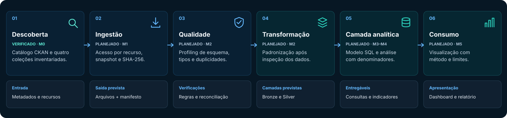
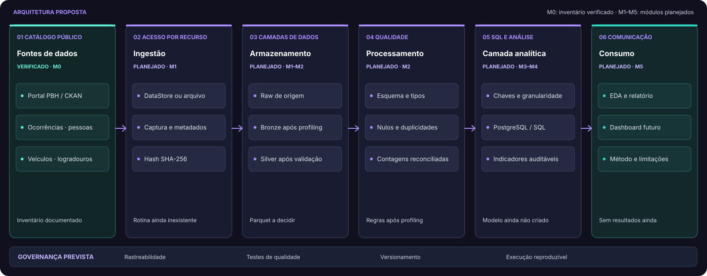

# BH Traffic Intelligence

**Dados públicos para investigar sinistros de trânsito com vítimas em Belo Horizonte.**

> **Em desenvolvimento · M0 (fundação e inventário).** Quatro coleções BHTRANS foram inventariadas no CKAN. Ainda não há pipeline executável, análises nem dashboard. [Acompanhe as evidências e pendências](PROGRESSO.md).

## Navegação

- [O projeto](#o-projeto)
- [Estado atual](#estado-atual)
- [Perguntas de investigação](#perguntas-de-investigação)
- [Visão geral do pipeline](#visão-geral-do-pipeline)
- [Arquitetura de dados](#arquitetura-de-dados)
- [Tecnologias](#tecnologias)
- [Fontes e cobertura](#fontes-e-cobertura)
- [Qualidade e rastreabilidade](#qualidade-e-rastreabilidade)
- [Resultados e demonstrações](#resultados-e-demonstrações)
- [Como acompanhar](#como-acompanhar)
- [Documentação técnica](#documentação-técnica)
- [Limitações e próximos passos](#limitações-e-próximos-passos)
- [Desenvolvimento assistido por IA](#desenvolvimento-assistido-por-ia)

## O projeto

O projeto organiza um caminho reproduzível para estudar os registros de sinistros com vítimas publicados pela BHTRANS: conhecer as fontes, preservar os arquivos originais, verificar a qualidade e, futuramente, analisar os dados com períodos, universos e métodos explícitos.

As quatro coleções no escopo são **ocorrências, pessoas, veículos e logradouros**. Esses dados não representam todos os eventos de trânsito da cidade. Contagens de registros também não medem risco viário sem dados adequados de exposição.

## Estado atual

| Estado | Componente | Evidência ou próximo marco |
|---|---|---|
| **Verificado** | Inventário CKAN das quatro coleções e de seus recursos | [Fontes documentadas](docs/data_sources.md), captura de 22/10/2026 |
| **Em desenvolvimento** | M0: fundação, ambiente e documentação | [Checklist da fase](PROGRESSO.md); gate ainda pendente |
| **Presença local, sem validação** | `data/raw/bhtrans/veiculos/si-veic-2023.csv` | Conteúdo, esquema, integridade e hash ainda não verificados |
| **Planejado** | Ingestão; qualidade e camadas; SQL e análise; dashboard | M1–M5, sujeitos aos gates do [progresso](PROGRESSO.md) |
| **Opcional** | Machine Learning | M6, condicionado a um caso de uso e avaliação de viabilidade |

## Perguntas de investigação

São perguntas futuras, dependentes da cobertura factual e dos campos que forem verificados:

- Como os registros se distribuem no tempo?
- Como variam entre regiões ou logradouros, se os dados geográficos permitirem?
- Como se caracterizam pessoas e veículos envolvidos, respeitando a granularidade de cada coleção?
- Quais lacunas e mudanças de esquema limitam comparações entre anos?

## Visão geral do pipeline

O fluxo resume a direção do projeto. **Somente a descoberta documental está verificada; as demais etapas são planejadas.** As setas indicam sequência de trabalho, não execução automatizada.

<picture>
  <source media="(max-width: 700px)" srcset="assets/pipeline-overview-mobile.svg">
  
</picture>

[Detalhes e critérios de cada etapa](docs/architecture.md).

## Arquitetura de dados

A arquitetura em camadas expressa responsabilidades previstas. **PostgreSQL, Parquet, dashboard e rotinas de ingestão ainda não estão implementados.** O acesso a cada recurso dependerá da disponibilidade observada no CKAN.

<picture>
  <source media="(max-width: 700px)" srcset="assets/data-architecture-mobile.svg">
  
</picture>

[Arquitetura proposta, evidências e restrições](docs/architecture.md).

## Tecnologias

| Situação | Tecnologia | Uso |
|---|---|---|
| Declarada | Python `>=3.12`, pytest e Ruff em [`pyproject.toml`](pyproject.toml) | Metadados do projeto; instalação limpa e testes ainda não validados |
| Planejada | Python para ingestão; Parquet se justificado pelo profiling | M1–M2 |
| Planejada | PostgreSQL local e SQL | M3; banco ainda não configurado |
| A decidir | Pandas ou Polars; Power BI ou Metabase | Escolhas dependentes de evidência e necessidade |

## Fontes e cobertura

O [Portal de Dados Abertos da PBH](https://dados.pbh.gov.br/) publica as quatro coleções BHTRANS inventariadas. Os metadados consultados em 22/10/2026 indicam recursos anuais de **2011 a 2024**. Esses anos são rótulos do catálogo; a cobertura factual dos arquivos ainda não foi confirmada.

O [inventário detalhado](docs/data_sources.md) registra recursos, formatos, datas informadas pelo CKAN, consultas ao DataStore e lacunas. Entre os recursos anuais ativos, 55 consultas ao DataStore responderam; `si-veic-2023` estava marcado sem DataStore e sua consulta respondeu HTTP 404. Duas requisições `HEAD` a arquivos retornaram HTTP 403 no ambiente usado. Isso não determina o acesso de outros clientes. Os metadados indicam licença **ODbL** para as quatro coleções; a licença do código ainda será definida.

## Qualidade e rastreabilidade

O inventário registra origem e metadados. O trabalho previsto inclui preservar `raw`, registrar snapshots e SHA-256, fazer profiling por recurso e ano, reconciliar entradas e saídas e validar chaves antes de modelar tabelas. **Essas rotinas ainda não existem.** O arquivo local de veículos de 2023 não é evidência de ingestão validada.

[Restrições arquiteturais](docs/architecture.md) incluem evitar dupla contagem em junções de coleções com granularidades distintas e manter BHTRANS e SENATRAN em análises separadas até uma auditoria formal de compatibilidade.

## Resultados e demonstrações

Ainda não há resultados analíticos, gráficos, capturas de dashboard ou demonstração executável validados. Esta seção será preenchida quando houver evidências reproduzíveis.

## Como acompanhar

Abra a pasta no VS Code e consulte [`PROGRESSO.md`](PROGRESSO.md) para a fase ativa, [`docs/data_sources.md`](docs/data_sources.md) para o inventário e [`docs/architecture.md`](docs/architecture.md) para a arquitetura. Ainda não há comando de execução de pipeline; instruções de instalação e execução serão publicadas após implementação e validação.

## Documentação técnica

- [Inventário e cobertura das fontes](docs/data_sources.md)
- [Arquitetura e responsabilidades por etapa](docs/architecture.md)
- [Marcos, gates e evidências](PROGRESSO.md)

## Limitações e próximos passos

Colunas, encoding, separador, nulos, duplicidades e datas dos fatos ainda não passaram por profiling. Datas de modificação no CKAN não são datas dos eventos. Séries históricas dependem de avaliar cobertura e compatibilidade entre anos; taxas de risco exigem denominadores de exposição.

O próximo passo é concluir os itens pendentes de **M0** e verificar seu gate. A ingestão pertence à M1 e depende de autorização para avançar de fase.

## Desenvolvimento assistido por IA

O projeto usa o OpenAI Codex como apoio ao desenvolvimento e à documentação. Decisões técnicas, validação dos dados e interpretação de resultados permanecem sob responsabilidade do autor. Nenhuma conclusão analítica será apresentada sem cálculo e conferência com dados reais.
