# 🚦 BH Traffic Intelligence

### Dados públicos para estudar os sinistros de trânsito com vítimas em Belo Horizonte

**Um projeto de portfólio em construção sobre engenharia e análise de dados públicos.**

---

## 🎯 Sobre o projeto

O **BH Traffic Intelligence** está sendo construído para organizar e analisar dados públicos de sinistros de trânsito com vítimas registrados em Belo Horizonte. A proposta é percorrer o ciclo de dados com rastreabilidade: conhecer as fontes, preservar os arquivos originais, validar a qualidade, preparar os dados e, depois, produzir análises que possam ser explicadas e reproduzidas.

O projeto ainda está no início. Neste momento, há um inventário verificado das quatro coleções da BHTRANS no Portal de Dados Abertos da PBH. A ingestão automatizada, as transformações, as análises e qualquer dashboard ainda não foram implementados.

> **Escopo:** dados de sinistros com vítimas publicados nas coleções selecionadas. O projeto não representa todos os sinistros de trânsito e não mede, por si só, o risco de uma via.

## 🧭 Estado atual

| Etapa | Estado |
|---|---|
| Fase ativa | **M0 — Fundação e inventário** |
| Catálogo CKAN | Quatro coleções e seus recursos inventariados em [`docs/data_sources.md`](docs/data_sources.md) |
| Arquivo bruto local | `data/raw/bhtrans/veiculos/si-veic-2023.csv` |
| Módulo de ingestão automatizada | Ainda não implementado; previsto para M1 |
| Limpeza, modelo analítico e consultas | Ainda não implementados |
| Análises e resultados | Ainda não produzidos |
| Dashboard ou publicação | Ainda não implementados |

O catálogo consultado apresenta recursos anuais de **2011 a 2024** nas coleções de ocorrências, pessoas, veículos e logradouros. As datas de atualização, formatos e disponibilidade no DataStore foram registrados recurso a recurso. Um caso requer atenção: o recurso de veículos de 2023 está marcado sem DataStore e sem formato informado nos metadados. O inventário explica também as limitações de acesso observadas durante a verificação.

O CSV local foi baixado manualmente. Seu esquema, integridade, codificação e hash ainda não foram verificados pelo projeto; por isso, ele não sustenta análises ou conclusões neste momento.

## 🔄 Fluxo do projeto

```mermaid
flowchart LR
    A["Portal CKAN da PBH<br/>4 coleções inventariadas"] --> B["Descobrir recurso, ano<br/>e metadados"]
    B --> C{"DataStore ativo?"}
    C -->|Sim| D["Consultar registros<br/>pela API CKAN"]
    C -->|Não| E["Baixar arquivo<br/>do recurso"]
    D --> F["data/raw<br/>snapshot, metadados e SHA-256"]
    E --> F
    F --> G["Profiling e validação<br/>esquema, datas e qualidade"]
    G --> H["Bronze<br/>dados próximos à origem"]
    H --> I["Silver<br/>dados tipados e documentados"]
    I --> J["PostgreSQL<br/>modelo e consultas"]
    J --> K["EDA e relatório<br/>métricas com denominadores"]
    K --> L["Dashboard<br/>se aprovado"]
    L -. após gate de viabilidade .-> M["Machine Learning<br/>opcional"]

    classDef checked fill:#dafbe1,stroke:#1a7f37,stroke-width:2px,color:#24292f;
    classDef partial fill:#fff4d6,stroke:#d4a72c,stroke-width:2px,color:#24292f;
    classDef planned fill:#f6f8fa,stroke:#8c959f,stroke-width:1px,color:#57606a;
    classDef optional fill:#f4edff,stroke:#8250df,stroke-width:1px,color:#3d246c;
    class A checked;
    class F partial;
    class B,C,D,E,G,H,I,J,K,L planned;
    class M optional;
```

**Estado do fluxo:** verde marca o inventário CKAN verificado; amarelo marca a camada bruta, onde há um CSV baixado manualmente, ainda sem hash ou profiling; cinza indica etapas planejadas; roxo indica Machine Learning opcional, condicionado a um gate de viabilidade. O DataStore não está ativo para todos os recursos, por isso o fluxo prevê consulta pela API ou download do arquivo conforme os metadados. O andamento do projeto está em [`PROGRESSO.md`](PROGRESSO.md).

## 🧰 Tecnologias previstas

As ferramentas abaixo são opções previstas para etapas futuras, não uma lista de componentes já configurados:

- **Python 3.12** para a ingestão e as transformações;
- **pytest** e **Ruff** para testes e qualidade de código;
- **PostgreSQL** local para consultas relacionais;
- **Parquet** para armazenamento analítico, se confirmado durante o desenvolvimento;
- **Power BI ou Metabase** como opção de apresentação, a decidir numa etapa posterior.

Pandas ou Polars ainda não foram escolhidos. A decisão deve vir depois da inspeção dos arquivos reais.

## 🗂️ Fontes de dados

As quatro coleções inventariadas são publicadas pela BHTRANS no [Portal de Dados Abertos da PBH](https://dados.pbh.gov.br/):

1. Relação de ocorrências de acidentes de trânsito com vítima;
2. Relação das pessoas envolvidas;
3. Relação dos veículos envolvidos;
4. Relação dos logradouros dos locais.

Os metadados consultados informam **Open Data Commons Open Database License (ODbL)** para essas coleções. Essa licença dos dados não define a licença do código do projeto, que continua pendente.

Consulte [`docs/data_sources.md`](docs/data_sources.md) para nomes dos recursos, anos, formatos, datas do CKAN, endpoints verificados e limitações. As datas de atualização dos recursos não devem ser confundidas com a data mais recente dos fatos registrados; esta última ainda não foi verificada nos arquivos.

## 🤝 Uso de Inteligência Artificial como apoio ao aprendizado

O projeto é desenvolvido com apoio do **OpenAI Codex** como ferramenta de aprendizagem e colaboração. A IA ajuda a decompor tarefas, faz perguntas para estimular o entendimento, explica conceitos e apoia a revisão e a implementação de código.

O objetivo é que eu consiga compreender e explicar as decisões do projeto, e não apenas receber código pronto. A validação das fontes, a interpretação dos resultados e as decisões finais continuam sob minha responsabilidade. Nenhum achado analítico será apresentado como resultado sem ter sido calculado e conferido com dados reais.

## ▶️ Como acompanhar no VS Code

Este repositório ainda não tem um pipeline ou comandos executáveis de ingestão. Para acompanhar o trabalho:

1. Abra a pasta do projeto no VS Code.
2. Consulte [`PROGRESSO.md`](PROGRESSO.md) para ver a fase ativa e as pendências.
3. Consulte [`docs/data_sources.md`](docs/data_sources.md) para revisar o inventário CKAN.
4. Na fase de ingestão, as instruções de ambiente e execução serão adicionadas aqui após a implementação e validação dos comandos.

Os arquivos brutos ficam sob `data/` e estão excluídos do Git pelo `.gitignore`; não os inclua em commits ou publicações.

## ⚠️ Limitações atuais

- O projeto ainda não tem código de ingestão, testes automatizados, banco configurado ou pipeline reproduzível.
- Os arquivos não passaram por profiling: colunas, codificação, separador, nulos, duplicidades e período factual permanecem desconhecidos.
- Os recursos são de sinistros com vítimas; não permitem generalizar automaticamente para todos os eventos de trânsito.
- Contagens de sinistros, sem dados de exposição adequados, não equivalem a taxas de risco.
- A compatibilidade entre anos precisa ser avaliada antes de formar séries históricas.
- Nenhum modelo de Machine Learning está aprovado ou em desenvolvimento nesta etapa.

## 📌 Próximas etapas

1. Concluir a fundação do projeto e os itens restantes de M0.
2. Após o gate de M0, iniciar M1 para descoberta e ingestão auditável, com logs, retries, hashes e testes com mocks.
3. Só depois do profiling, avançar para qualidade, modelagem analítica e investigação dos dados.

---

**Projeto de estudo em andamento · Belo Horizonte, MG**

