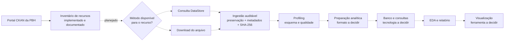

# Arquitetura do BH Traffic Intelligence

> Estado desta documentação: 22/10/2026. O projeto está em M0. As etapas descritas como planejadas são uma direção de trabalho, não componentes executáveis.

## Estado implementado

O trabalho técnico registrado até aqui é o inventário de metadados de quatro coleções BHTRANS no CKAN, documentado em [`data_sources.md`](data_sources.md). Foram consultados `package_search`, `resource_show` e `datastore_search`. A captura registrou respostas bem-sucedidas do DataStore para os recursos ativos testados e uma resposta HTTP 404 para `si-veic-2023`, marcado no catálogo com `datastore_active=false`.

O arquivo `data/raw/bhtrans/veiculos/si-veic-2023.csv` existe localmente e `data/` é ignorado pelo Git. O arquivo não foi inspecionado pelo projeto; não há hash, manifesto, profiling ou resultado validado associado a ele.

Não há ainda código de ingestão, transformação, banco de dados, consultas analíticas ou visualização. `pyproject.toml` declara Python `>=3.12` e pytest/Ruff como dependências de desenvolvimento, mas não há validação registrada de instalação limpa, execução de testes ou CI.

## Fluxo lógico proposto

O acesso deve ser escolhido por recurso após consultar os metadados e verificar o endpoint: consultar o DataStore quando estiver ativo e acessível; caso contrário, avaliar o download do arquivo publicado. A captura de `docs/data_sources.md` observou que disponibilidade e formatos não são uniformes. A etapa de download ainda não está automatizada.

Somente o inventário está implementado. Os nós tracejados representam etapas futuras condicionadas aos gates registrados em [`../PROGRESSO.md`](../PROGRESSO.md). O fluxo evita presumir que todo recurso esteja no DataStore ou que todas as coleções tenham o mesmo esquema.

## Responsabilidades previstas por etapa

| Etapa | Responsabilidade prevista | Estado e evidência |
|---|---|---|
| Catálogo | Descobrir conjuntos e recursos; registrar identificadores, anos, formatos e datas informados pelo CKAN | Inventário documentado em [`data_sources.md`](data_sources.md) |
| Acesso ao recurso | Verificar DataStore e usar consulta ou download conforme disponibilidade | Endpoints verificados durante o inventário; rotina automatizada ainda não existe |
| Ingestão bruta | Preservar a resposta/arquivo de origem e registrar origem, data de captura, ano, tamanho e SHA-256 | Planejada para M1; não implementada |
| Profiling | Inspecionar campos, encoding, separador, nulos, duplicidades, datas e mudanças de esquema | Planejado para M2; o esquema dos arquivos ainda não foi verificado |
| Preparação analítica | Definir transformações e formatos a partir do profiling; manter rastreabilidade e reconciliação | Planejada; ferramentas e formatos permanecem pendentes |
| Banco e consultas | Definir granularidade, chaves e consultas após validar cardinalidade | Planejada para M3; banco ainda não configurado |
| Análise e apresentação | Responder perguntas com universo, período, denominadores e limitações explícitos | Planejada; não há resultados ou dashboard |

## Restrições arquiteturais já registradas

- Preservar os dados brutos e mantê-los fora do Git: `data/` está no [`.gitignore`](../.gitignore).
- Não inferir esquema, chaves ou granularidade antes de inspecionar os dados.
- Não tratar datas de modificação do CKAN como período dos fatos.
- Não juntar BHTRANS e SENATRAN numa série temporal sem auditoria de compatibilidade.
- Distinguir contagem de sinistros com vítimas de medida de risco; uma taxa exige dados de exposição adequados.

Essas restrições também aparecem em [`AGENTS.md`](../AGENTS.md) e [`PROGRESSO.md`](../PROGRESSO.md). Não há ADRs formais em `docs/decisions/` neste estágio.

## Escolhas ainda pendentes

O projeto ainda não escolheu biblioteca de transformação (Pandas ou Polars), formato analítico, banco, ferramenta de BI nem licença para o código. PostgreSQL, Parquet, Power BI e Metabase aparecem como possibilidades de etapas futuras no progresso/plano, não como serviços configurados. Essas escolhas devem ser feitas quando houver evidência dos dados e necessidade concreta.
